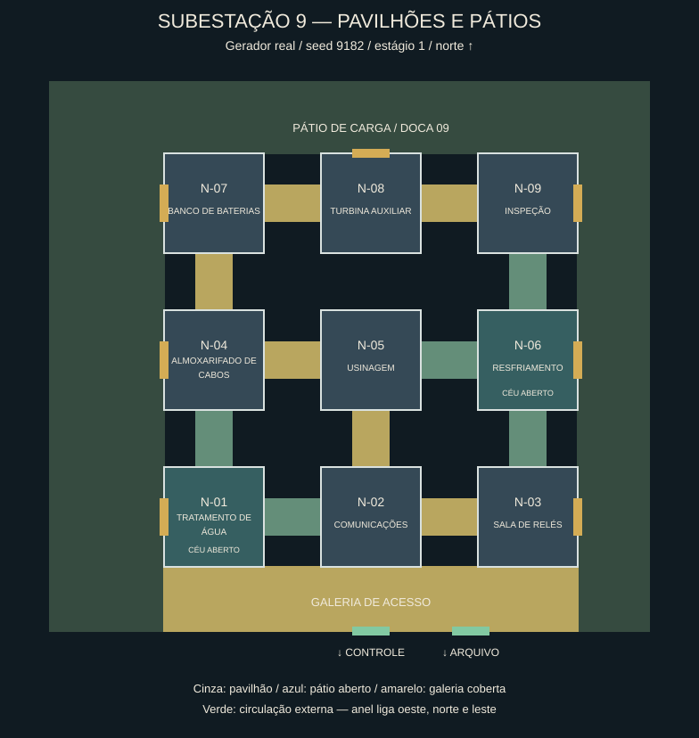
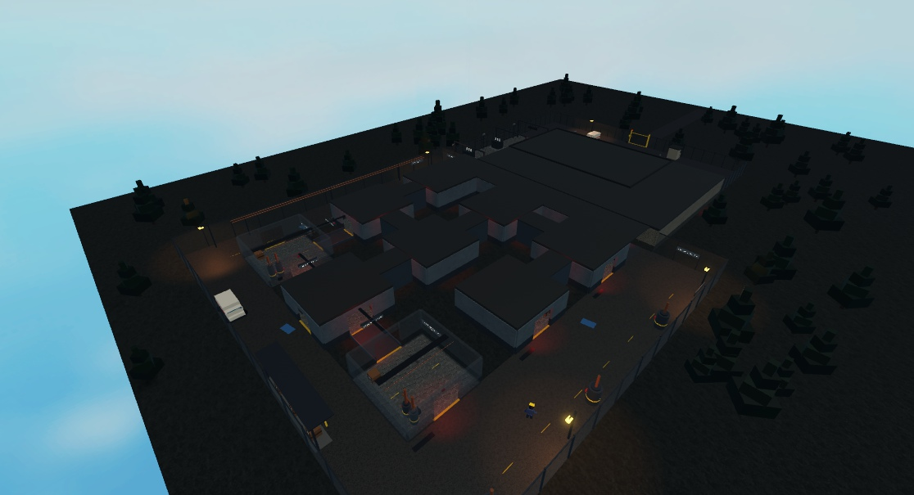

# Circulação, pavilhões e áreas externas

16/10/2026. Fonte: `src/`; melhorias do mapa separadas da frente de HUD/ajuda.

A ala norte deixa de ser um bloco de nove salas coladas. As salas técnicas de 28×28 studs
ficam em pavilhões com 16 studs de separação, ligados por passagens reais de dez studs de largura.
Uma galeria coberta de 116×18 distribui os acessos do controle e do arquivo aos três primeiros
pavilhões e às duas laterais externas. Os vãos antigos do núcleo continuam nas mesmas posições.

Resfriamento e tratamento de água passam a ser pátios técnicos sem teto, cercados, com suas
atividades no mesmo sistema de slots. As ligações até esses pátios são passarelas abertas;
entre pavilhões internos há galerias cobertas. O gerador continua sorteando funções, equipamentos
e conexões por seed/estágio; o modo História conserva sua planta fixa entre capítulos.

O anel externo conecta oeste, norte e leste: via de manutenção com tanques e drenagem, pátio de
carga com doca, cobertura e van, e passagem de tubulações. Os pavilhões laterais e o pavilhão
central ao norte abrem para esse anel. Assim há uma rota de contorno real para exploração e fuga.
Postes, marcações, poças e placas dão identidade aos trechos. As cercas se encontram com o
perímetro antigo; a saída da partida continua dependendo do portão frontal.

O Vigia recebe pontos de patrulha nos corredores e nos trechos externos. A detecção de interior
agora usa as salas e passagens que têm cobertura, em vez do retângulo inteiro da ala. O chão de
fundo e a exclusão de árvores acompanham o novo perímetro, sem árvores nas rotas.

## Planta reproduzível

Gerada diretamente de `ProceduralLayout.create(9182, estágio)`; não é uma reconstrução manual.

[Estágio 2](evidence/map-circulation/plan-stage-2.svg) ·
[Estágio 3](evidence/map-circulation/plan-stage-3.svg) ·
[Dados completos](evidence/map-circulation/plans-9182.json).

Vista real do build integrado. Luz diurna, névoa afastada e HUD oculto **somente na inspeção**;
o jogo continua noturno. A captura não representa a iluminação normal da partida.

[Corredor sem energia, com iluminação normal](evidence/map-circulation/corridor-unpowered.png).

## Verificação e reprodução

O QA usa uma cópia congelada de `88aae72` mais os sete arquivos desta frente, em
`.cache/map-circulation-candidate`. Nenhum script foi editado pelo Studio.

- `lune run scripts/check`: ALL GREEN na cópia isolada, 237 testes puros aprovados.
- Check integrado observado durante a entrega: ALL GREEN, 248 aprovados, cinco specs de Studio pulados.
- Runner completo no Studio: **275 aprovados na integração final**, zero falhas e nenhum erro do jogo
  no console; 261 aprovados na primeira cópia isolada. Nove plantas (três seeds × três estágios)
  verificam caminhos para jogador e Vigia, equipamentos fora da circulação, vãos reais por raycast,
  tetos dos pátios, acessos pelo núcleo e contorno externo com os pavilhões bloqueados.
- Campanha padrão com oito clientes: `Won`, estágio 3, **134 verificações aprovadas**; inclui
  reconstrução física entre estágios, navegação às estações e extração da equipe.
- História com três clientes: `Won`, capítulo 3, **59 verificações aprovadas**; seed `90312` e
  planta conservadas entre capítulos e reinícios. Ambos os recibos vêm da cópia congelada.
- O fechamento do portão original continua coberto pelo spec de navegação existente.
- O orçamento de arte continua reservado em 16 superfícies; os pisos/props da ala reutilizam
  as tags existentes. O spec limita a ala a menos de 800 peças físicas por planta.
- Amostra integrada: 654 peças na ala, sete tetos de pavilhão e dois pátios técnicos abertos.
  O Play de QA foi encerrado, descartando as alterações temporárias de câmera/luz.

Recibos finais e hashes: [evidence/map-circulation](evidence/map-circulation).

Para reproduzir: `lune run scripts/check`, gerar uma place com `rojo build default.project.json`,
abrir essa cópia local e rodar `Tests.Run` em Play via MCP. A cópia descartável de revisão é
`build/MapCirculationIntegrated.rbxlx`, com o código integrado observado nesta entrega.
`build/MapCirculation.rbxlx` é a cópia isolada usada nos testes multiplayer. Nenhuma é um arquivo
para publicação.

## Limites

A place compartilhada `Roblox Teste` foi encontrada com as duas raízes `NotSynced`, com código
anterior e sem `SectorExterior`. Os resultados acima vêm dos builds locais com scripts embutidos;
não comprovam atualização dessa place. Para usar o checkout nela, o integrador precisa reativar
Script Sync para as duas raízes, apontando para este `src/`.

O QA automatizado da campanha usa teleporte de setup e IA congelada. Ritmo de exploração,
balanceamento de perseguição e desempenho em dispositivos fracos ainda precisam de partida humana.
Não houve push ou publicação.
