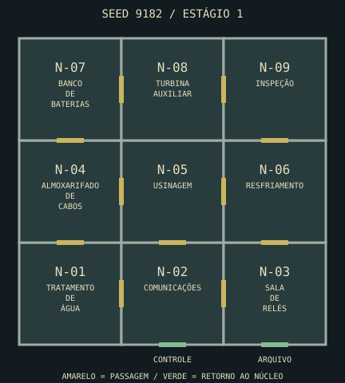
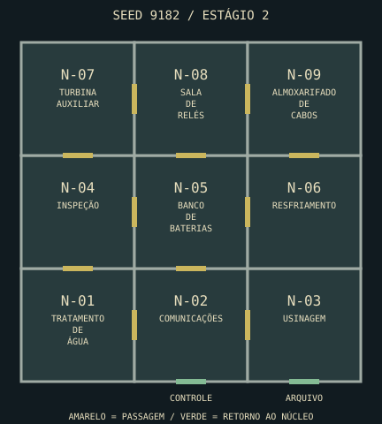
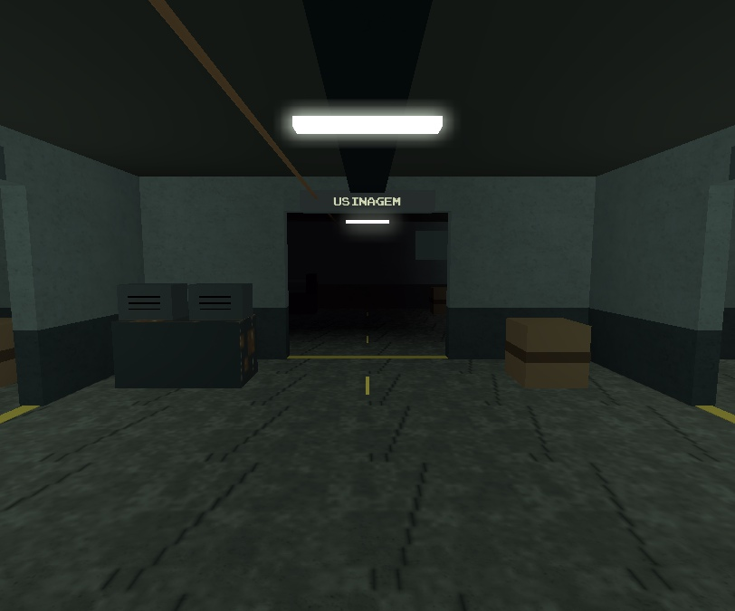
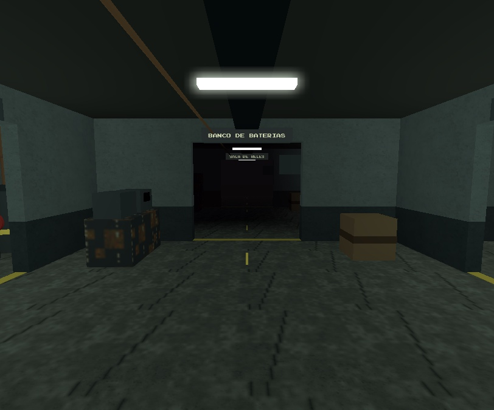
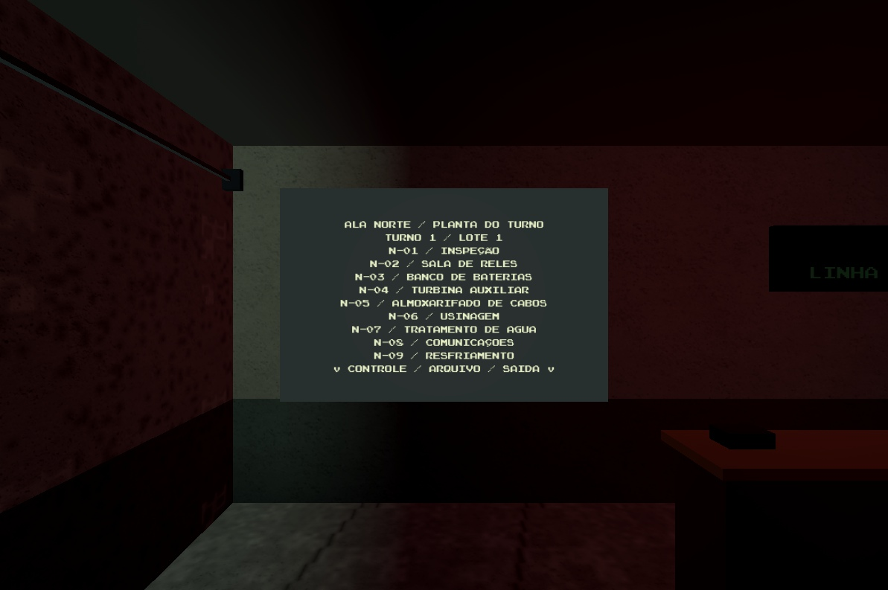

# Mapa por rodada — ala norte modular

16/10/2026. Implementação Codex sobre a frente integrada de arte e os commits de loja do Claude.
Código: commit local `cad0d12`. Sem push ou publicação. Dev devolvido em Edit após a validação.

**Fronteira do QA:** base estável `cabb1ec` + esta frente. Os testes finais do mapa passaram
antes das novas alterações simultâneas de temporada e animação; essas frentes ficaram preservadas
e fora desta validação/commit. O check final também foi repetido numa cópia congelada dessa base.

## Resultado

A subestação ganhou uma ala coberta de **84×84 studs**, com **nove salas de 28×28** e duas entradas
pelo controle e pelo arquivo. São **7.056 studs² adicionais**: +41,3% sobre a área do complexo
anterior (17.080 → 24.136 studs², soma das áreas, sem contar o fundo decorativo).

Cada rodada/estágio reconstrói fisicamente a ala: muda a distribuição das funções, a posição e
orientação dos equipamentos e quais paredes têm passagens. As funções são sala de relés,
resfriamento, banco de baterias, comunicações, usinagem, inspeção, almoxarifado de cabos,
turbina auxiliar e tratamento de água. O núcleo, o spawn e a saída são referências estáveis.

A campanha distribui 60% das estações, arredondados para cima, entre as novas salas; as demais
continuam explorando o núcleo. A mesma seed + estágio reproduz a planta; tamanho do grupo escala
as atividades sem redesenhar o espaço para quem entra tarde. Reinício completo cria nova seed;
servidor esvaziado também encerra a seed anterior. A opção de seed fixa continua útil para QA.

No solo, a ala também muda no reinício completo. **Continuar do checkpoint conserva o mapa**,
além dos fusíveis, itens e portas restaurados pelo sistema existente.

## Circulação e imersão

- Árvore conectada por Kruskal sorteado + 1–3 conexões extras: 9–11 passagens internas.
- Duas entradas, vãos de 10×9, teto de 11 e cruzamentos livres de equipamentos. O quadrante
  sudeste de cada sala reserva espaço para o terminal e a dupla do relé.
- Modelos por função: tanques/válvulas, racks, rádios, torno, bancada de inspeção, bobinas e turbina.
  Condutos altos, faixas no piso, luzes de emergência e iluminação ligada à energia do mundo.
- Placas de destino e diretório do turno acompanham o sorteio. A indicação SAÍDA segue o caminho
  mais curto até uma das entradas, calculado sobre as passagens reais.
- Patrulha e surgimento do Vigia incluem a ala: 26 pontos de patrulha e 13 pontos de surgimento.
  A área é reconhecida como interior. Árvores e fundo foram afastados/prolongados para a expansão.
- Jogadores ficam congelados na transição; o Vigia reinicia antes da troca. A geometria nova fica
  pronta antes de remover a ala anterior. Portas/itens/interações do núcleo conservam seus handles.

## Orçamento e ciclo de vida

`ArtBuilder` reserva 16 das 160 superfícies globais para a ala. Ela usa 13; total medido **157**.
O cliente libera texturas, telas e emissores removidos a cada reconstrução. Mantidos os tetos
de 360 texturas e cinco imagens RGBA 32×32 compartilhadas (20 KiB de pixels lógicos).

Em 13 reconstruções medidas, sendo 12 sucessivas com intervalo de 0,5 s: **320 texturas,
sete CRTs e 19 emissores**, contagens internas iguais às instâncias existentes; pico observado
de construção de **8,75 ms** e passo de arte de **0,33 ms**. A ala tinha 333 peças na última
amostra, 345 nas capturas. Essas medições são do Studio nesta máquina, sem promessa de FPS em outros dispositivos.

## Validação

| Prova | Resultado |
| --- | --- |
| `lune run scripts/check` | ALL GREEN; 182 testes puros |
| Planos puros | 1.500 plantas + 3.600 planos de campanha; conectividade, loops, diversidade, retorno e slots |
| Runner Studio | 205 aprovados, zero falhas |
| Navegação física | Nove plantas (seeds 1/42/9182 × estágios 1/2/3), todos os destinos pelo jogador e Vigia, paredes conferidas por raycast; duas entradas integradas aprovadas |
| Três clientes reais do Studio | Won, estágio 3, 64 verificações; seed 1792154867 |
| Oito clientes reais do Studio | Won, estágio 3, 134 verificações; seed 1792155190 |
| Solo / checkpoint | Geometria e seed preservadas após Lost → checkpoint; reinício completo mudou ambas |
| Script Sync no Dev | Duas raízes SyncedAsRoot, zero descendentes fora de sync; módulos/integração novos presentes |

O harness cooperativo verifica novo mapa no reinício, substituição física entre estágios,
estações resolvidas pelos remotes normais, distância/visão do servidor, captura/resgate,
desconexão/entrada tardia e extração. Teleporta o setup e congela a IA para isolar regras;
o Vigia também foi observado em patrulha normal dentro da ala em inspeção separada.

O primeiro teste de oito clientes expirou antes de todos se conectarem e não executou checks de
gameplay. Seu recibo foi preservado; após fechar as prévias descartáveis antigas, a repetição
completou todos os estágios e a extração com 134 verificações aprovadas.

## Comparação reproduzível

As plantas abaixo vêm do gerador real, seed 9182. Amarelo indica passagem, verde indica retorno
ao núcleo. As coordenadas e conexões completas estão em [plans-9182.json](evidence/random-map/plans-9182.json).

| Estágio 1 | Estágio 2 |
| --- | --- |
|  |  |

Mesmo ponto de câmera; placas, equipamentos e conexões acompanham o estágio. Capturas de inspeção
com energia ligada nos dois casos e HUD oculto; a primeira fase normal continua começando sem energia.

| Estágio 1 | Estágio 2 |
| --- | --- |
|  |  |

Na revisão final, o diretório saiu da parede dos monitores e foi para a parede sul do controle.
Leitura confirmada no Dev sincronizado; ajuste somente de posição/orientação da placa, sem colisão
ou raycast. O runner completo foi repetido na integração atual após o ajuste.

## Arquivos e reprodução

- `World/ProceduralLayout`: planta pura, validação, slots e rotas de retorno.
- `World/SectorBuilder`: estrutura e modelos; `WorldService`: reconstrução, interior e nós da IA.
- `CampaignGenerator`/`CampaignRuntime`: sorteio e transição; `CampaignCatalog`: nomes das funções.
- `ArtBuilder`/`ArtController`: reserva de orçamento e descarte. `Layout`/`Expansion`/`MapBuilder`:
  acessos, circulação existente e entorno. Sem novos remotes ou esquema persistente.
- `Tests/Specs/ProceduralLayout`, `ProceduralNavigation`, `Tests/CampaignHarness`.

Check: `lune run scripts/check`. No Studio, confirmar Script Sync e rodar `Tests.Run` em Play.
Multiplayer opt-in: `StudioTestService:ExecuteMultiplayerTestAsync(3 ou 8, {campaignQA=true, players=3 ou 8})`.
QA multiplayer usou builds descartáveis; a integração final e a placa foram verificadas no Dev
sincronizado. Os scripts foram editados somente no repositório. `source-manifest.json` registra
hashes finais e do snapshot multiplayer; a única diferença na frente do mapa é a placa descrita acima.

Recibos em [evidence/random-map](evidence/random-map): testes, campanha, ciclo de vida, checkpoint,
plantas e capturas. O balanceamento de deslocamento, sustos e leitura das placas ainda pede
uma partida humana completa em grupo e medição em dispositivo mais fraco.
