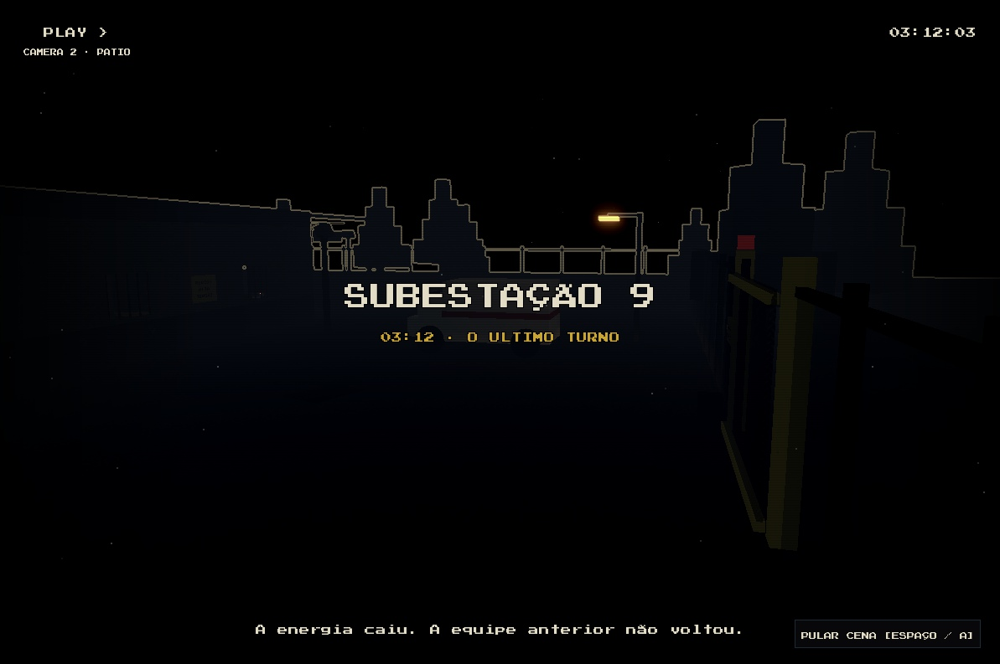
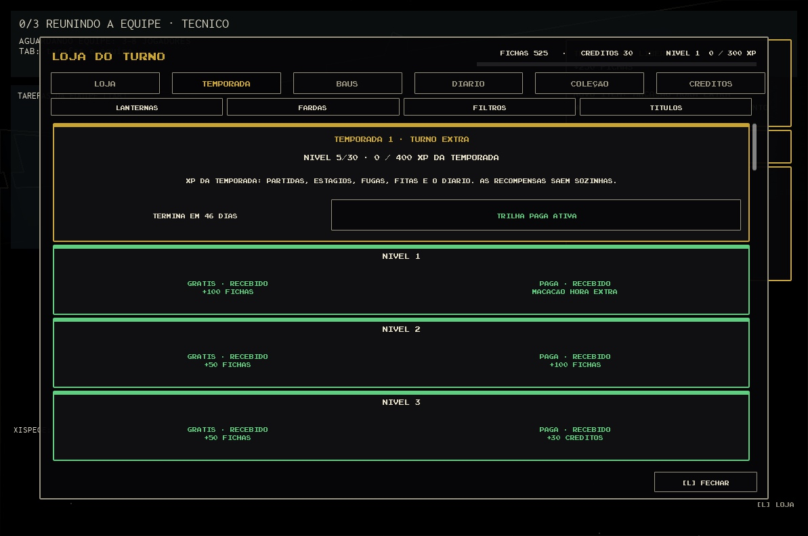

# Retomada dos dois chats — SUBESTAÇÃO 9

16/10/2026. Repositório `C:\Users\xpg\Documents\roblox-teste`, branch `claude/polish-terror`.

## Identificação confirmada

| Chat da imagem | Sessão Claude | Trabalho recuperado |
| --- | --- | --- |
| Ambiente Roblox + Claude Code (fork) | 1135ac66-f6b6-4996-9bb0-433465c51918 | Animações, transições, abertura, jogadores e Vigia |
| Analytics de economia e passe de temporada | 460f9925-907b-47e3-a8b3-ebf4ecb7a682 | Telemetria, PlayerData v3 e passe Turno Extra |

Os dois históricos terminaram por limite de uso. A identificação foi confirmada pelos títulos,
últimos pedidos e arquivos editados nos JSONL locais do Claude. Não foram tratados como novos pedidos
os lembretes de sistema, instruções citadas ou propostas não iniciadas que aparecem nos históricos.
Snapshot original das alterações herdadas: `.cache/resume-two-chats/original.zip` (local, ignorado).

## Entregas

**Economia/temporada — `be50b06`.** Aba TEMPORADA, 30 níveis, XP separado, duas trilhas, entrega
retroativa ao comprar o passe e concessões idempotentes. Migração de v2 para v3 preserva carteira e
inventário. Game Pass `turno_extra_s1` com ID 0, exclusivamente simulado no Studio. Analytics separa
fontes/sumidouros, níveis da conta, duplicatas e trilhas; saldo após cada evento. Funil abrir → escolher
oferta → compra, compra registrada pelo servidor. Regras novas e migração cobertas por testes.

**Animações/transições — `1602f3d`.** Overlay de faixas/pálpebras/fade/estática/carimbo/cartela/legenda;
abertura no lobby/intro e cena de fuga, Espaço/A/botão para pular. Sem filme longo durante etapa ativa:
apenas piscada curta. Movimento reduzido usa cortes estáticos; flashes desligados usam véu estável.
CameraController continua único compositor, mantém Focus e restaura CFrame ao terminar/cancelar.
Captura, esconderijo e espectador têm prioridade. HUD coop e mão da lanterna somem durante cenas.

Poses procedurais R15: olhar, agachamento, corrida, incapacitado e resgate. Motor6D/AnimationConstraint chegam de forma
assíncrona: o controller aguarda HasAppearanceLoaded e captura os offsets completos. LookPitch passa por Guard e rate limit
no PresenceService e só serve para aparência. Lanternas dos colegas são locais, sem colisão,
sem sombras e com distância máxima de 100 studs; removidas ao sair/renascer. Mão em primeira pessoa
levanta, abaixa ao agachar/correr, alcança na interação e reage ao interruptor. Vigia ganha Notice,
Sniff, DoorBang e Lunge; BangSerial só comunica a pancada, sem alterar regras da IA.
Objetivo, legenda, bilhete e resultado recebem transições curtas respeitando conforto.

## Evidência e fronteira de validação

- Check isolado economia: ALL GREEN, 190 testes puros.
- Check integrado das duas frentes: ALL GREEN, 201 testes puros; lint zero erros/warnings.
- Studio Dev: 224 aprovados, zero falhas, nenhuma spec pulada. Sync de ambas as raízes confirmado.
- Loja: trilha grátis no nível 1; 1.600 XP de temporada leva ao nível 5; compra simulada libera
  recompensas pagas anteriores (+250 Fichas, +30 Créditos, farda e lanterna); recompra retorna store_owned.
  Histórico contém OpenStore, ViewOffer e Purchase, com a mesma sessão, e fontes das duas moedas.
- Campanha de três clientes: Won no estágio 3, 64 verificações aprovadas.
- Campanha de oito clientes: Won no estágio 3, 134 verificações aprovadas. Confirmadas sete lanternas
  locais por cliente; cliente 1 tinha sete luzes habilitadas. Esses roteiros precedem a correção final
  do suporte a AnimationConstraint, espera de aparência e mudança da ponte QA para um ScreenGui persistente.
- O harness congela o Vigia e teleporta jogadores para setup; não comprova equilíbrio da perseguição.
- Avisos FoundationProvider/UIBlox apareceram nos CorePackages do Studio; não são logs do projeto.

Snapshot congelado: `.cache/two-chats-final`, base `a1bce3d` mais somente as duas frentes.
Manifesto em `evidence/two-chats/source-manifest.json`. Builds descartáveis: TwoChatsFinal e
TwoChatsVerified (correções finais). O modo história de outro chat ficou fora desse snapshot;
suas alterações em Main.client/Remotes foram preservadas e não foram incluídas por engano nos commits.

## Verificação final das correções

No Dev, check global ALL GREEN (206 puros) e runner Studio 229 aprovados (inclui specs da outra
frente). QA focado após as correções: 15/15 AnimationConstraints reconhecidas, Neck/Waist/RightShoulder
com rotações diferentes da identidade e posições-base preservadas. A ponte QA sobrevive ao spawn.
Espaço pula a cena, oculta o botão, zera os overlays e volta ao modo normal/FOV 72; diferença de posição
medida de 0,0012 stud (balanço normal). Movimento reduzido: diferença zero entre amostras do mesmo plano.
A compra simulada e a recusa de recompra foram repetidas depois dessas correções.

O menu do modo história, criado em paralelo, fica acima das cenas no lobby. Para a captura da cena
no Dev, somente esse ScreenGui foi removido temporariamente do PlayerGui e depois restaurado; para
a captura final da loja ele foi ocultado apenas em runtime e o Play foi encerrado. Isso é setup de QA,
não prova de integração visual do menu de história. Nenhum arquivo dele foi alterado por esta frente.
O foco cinematográfico foi validado com cenário visível. A API de foco foi conferida na
[documentação oficial de câmera](https://create.roblox.com/docs/workspace/camera), e o novo tipo de
articulação na [documentação de AnimationConstraint](https://create.roblox.com/docs/reference/engine/classes/AnimationConstraint).

O arquivo `qa-final.json` inclui a medida de movimento reduzido anterior ao ajuste do skip; o registro
`skip` contém a verificação final aprovada da tecla. Todos os plays desta frente foram encerrados.

## QA reproduzível

`lune run scripts/check`; playtest no build congelado; `require(game.ServerScriptService.Tests.Run)()`.
No cliente em Studio, `PlayerGui.CinematicControls.AnimationDebugBridge:Invoke("scene", "Opening")`
(iniciar), `Invoke("skip")` (parar), `Invoke("motion", false)` (movimento reduzido) e `Invoke("state")`
(estado da VM real). A ponte só existe no Studio. ServerStorage.DebugBridge oferece seasonXp e analytics.
Campanha multi-cliente usa a receita de COOP_QA.md com campaignQA=true/players=3 ou 8.

## Limites

Sem publicação, Creator Hub, compra real ou push. Analytics real, DataStore real, conta restrita real,
mobile, controle físico, FPS/balanceamento com jogadores e integração final com o modo história ainda
exigem QA próprio. R6 não tem a mesma cobertura das poses R15; conserva animação padrão onde faltam juntas.
A migração não substitui validação de persistência em dois servidores publicados.