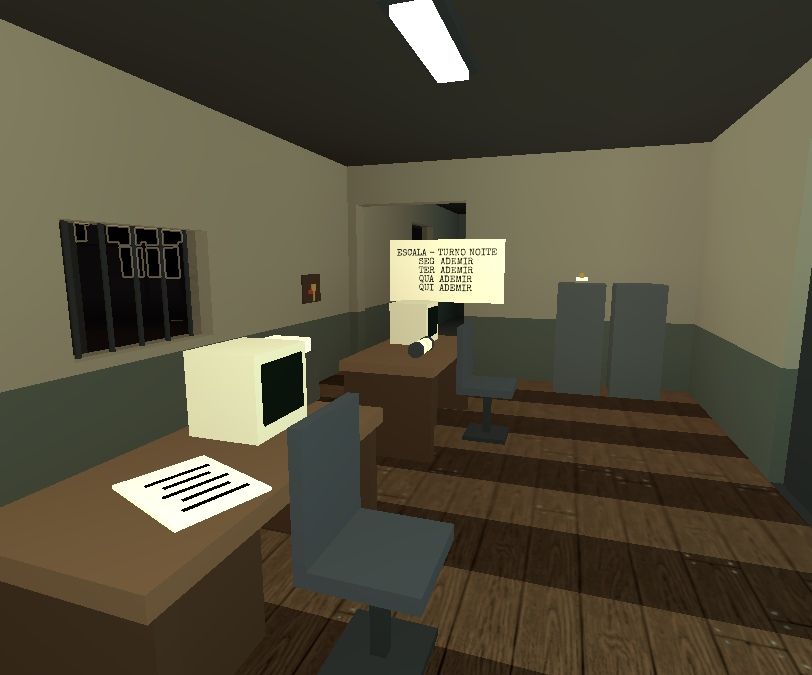
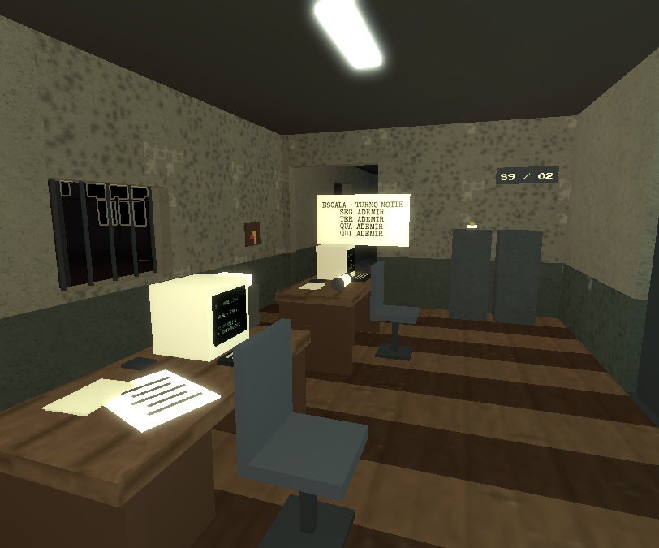

# Polish visual — Subestação 9

16/10/2026. Base `9d40d44`, mesma branch. Direção: instalação industrial brasileira envelhecida,
paleta curta, baixa resolução e leitura de silhuetas. Código, imagens e efeitos reconstruídos do repositório.

## Entregue

- Cinco padrões autorais RGBA 32×32: tinta gasta, concreto, oxidação, madeira e rejunte.
  Gerados localmente com seed estável, sem imagens externas ou uploads. 20 KiB de pixels RGBA por cliente
  (fora o overhead de objetos/renderização),
  com fallback para materiais nativos quando EditableImage não estiver disponível.
- Materiais e desgaste distribuídos entre todas as salas. Orçamento de 160 peças texturizadas /
  360 faces; observado: 330 Texture nativas. DiamondPlate do gerador preservado.
- Setores numerados, conduítes, caixas de junção, painéis auxiliares com escala/ponteiro,
  marcas de umidade e óleo. Acréscimos decorativos sem colisão ou participação nos raycasts.
- Mesas com teclado, arquivos e disquete, etiquetas em gavetas, sarrafos/rótulos em caixotes,
  parafusos e placa no gerador. Footprints e pontos dos objetivos preservados.
- Vigia com cabelo/nuca, bolsos, costuras, distintivo, cinto/fivela, rádio/antena, punhos,
  dedos e solas. 22 peças adicionais seguem as poses existentes no mesmo BulkMoveTo.
  Rosto fotográfico, fallback geométrico, IA e captura preservados.
- Medidores e LEDs locais em passos de 12 Hz, seis CRTs com texto/scanlines, poeira limitada
  por distância e faíscas curtas dos disjuntores respeitando a opção de clarões.

## Referências e decisões

[Bradwell — documentação fotográfica](https://www.28dayslater.co.uk/threads/bradwell-132kv-substation-essex-sept-2019.121085/)
serviu como referência de equipamentos analógicos, gabinetes e instalações aparentes. Nenhuma foto
foi usada como textura. A linguagem retrô segue a especificação existente, incluindo SIGNALIS;
[página oficial do jogo](https://store.steampowered.com/app/1262350/).

APIs conferidas na documentação oficial:
[EditableImage](https://create.roblox.com/docs/reference/engine/classes/EditableImage),
[Texture](https://create.roblox.com/docs/reference/engine/classes/Texture),
[Decal.ColorMapContent](https://create.roblox.com/docs/reference/engine/classes/Decal),
[SurfaceGui](https://create.roblox.com/docs/reference/engine/classes/SurfaceGui).
Materiais/texturas permanecem locais; nenhuma dependência de modelo do Creator Store.

## Comparação

Mesmo enquadramento, 70° de FOV, energia ligada e pós-processamento da arte existente.
HUD/filtro 2D ocultos apenas no probe de captura para inspecionar os materiais.

| Antes (`9d40d44`) | Depois |
| --- | --- |
|  |  |

Capturas adicionais e recibos em `docs/evidence/visual-polish/`.

## QA e limites

Check ALL GREEN: 151 testes puros. Studio: 162 aprovados, zero falhas. Três novos testes do engine
verificam decoração sem bloqueio, cobertura/orçamento de superfícies e todos os adornos/poses do Vigia.
O runner inclui navegação real para jogador e criatura.

Mapa: 1.413 → 1.617 peças no servidor (+204, aproximadamente 14%). Cinco bitmaps, seis telas,
dez emissores de poeira (ativados por distância) e seis indicadores na primeira leitura do cliente.
O custo de atualização local e as condições da amostra são registrados separadamente; isso
não substitui FPS/latência numa partida humana, nem é garantia de 60 FPS em outros dispositivos.

A captura do Studio Dev ficou sem renderização 3D; gráficos e dados estavam presentes, mas a imagem
era plana. Usamos uma cópia descartável recém-aberta, que renderizou corretamente. O arquivo
`capture-flat-rejected.png` preserva a tentativa descartada. Não foi usada como validação visual.
Comparação anterior construída de um git archive de `9d40d44`, sem checkout/reset do diretório ativo.

Iterações visuais reduziram o contraste da tinta gasta e substituíram a ferrugem nativa exagerada
por metal com máscara de oxidação. A face dos monitores de controle foi corrigida para o lado do leitor.
Todos os ajustes de câmera/energia/Vigia usados para as imagens são fixtures temporárias de Play.

## Concorrência e reprodução

Código da camada visual: `fdb50c4`. Durante o trabalho, o Claude retomou outra frente no mesmo
diretório e commitou duto, navegação, UI e haptics em `9e3931e`. Essas mudanças foram preservadas.
Não fazem parte do escopo de arte nem das imagens comparativas. O QA visual foi congelado em
`9d40d44` + somente os arquivos desta camada (`.cache/art-candidate` / VisualFinal.rbxlx).
Check isolado ALL GREEN (151) e runner 162; regressão com oito clientes Won no estágio 3,
125 verificações, seed 1792136884, em `eight-clients-final.json`.

O commit de arte tem `9e3931e` como pai porque o trabalho compartilhado avançou antes do commit.
Um segundo snapshot `.cache/art-integrated`, exportado do commit `fdb50c4`, conserva essa integração:
check ALL GREEN (151) e build ArtIntegrated.rbxlx. Ele exclui futuras edições/monetização em andamento.
Não afirmar que o QA congelado valida alterações posteriores de outra frente.

**Integração no Studio: NOT READY.** O snapshot `fdb50c4` passou 163 testes e falhou em um novo
teste da frente do Claude: `Navigation > crawl duct: crouched agent goes through, creature never does`,
linha 132. O engine encontra uma rota, mas o teste exige que ela passe pelo duto e essa condição não
foi satisfeita. Recibo em `integration-tests.txt`; Layout/Navigation da outra frente foram preservados.
O resultado isolado de 162 testes e a campanha de oito acima continuam válidos para a camada de arte
sobre a base anterior. Este aviso impede confundir essa evidência com aprovação do duto novo.

**Atribuição confirmada:** um build separado de `9e3931e`, sem nenhum arquivo de arte, retornou
157 aprovados / a mesma falha de Navigation na linha 132. Recibo `duct-baseline-9e3931e.txt`.
Portanto a falha do duto já existe na base da outra frente. Nenhum arquivo dela foi revertido/editado.
Todas as sessões de Play usadas pelo Codex foram encerradas; o Dev foi liberado em Edit.

Continuam separados: avaliação humana da arte no fluxo normal da partida, legibilidade no escuro,
desempenho com hardware alvo/mobile e balanceamento. Não houve alteração de publicação ou Creator Hub.
