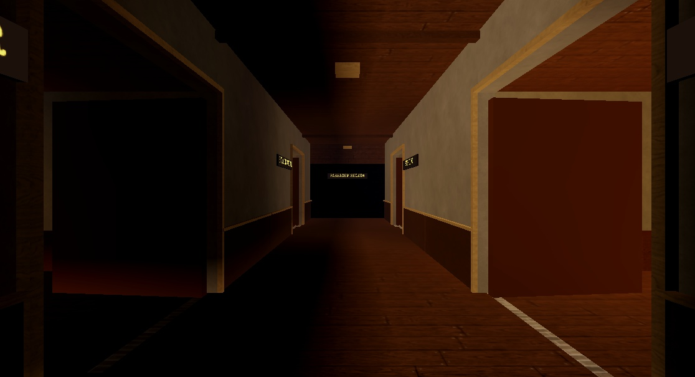
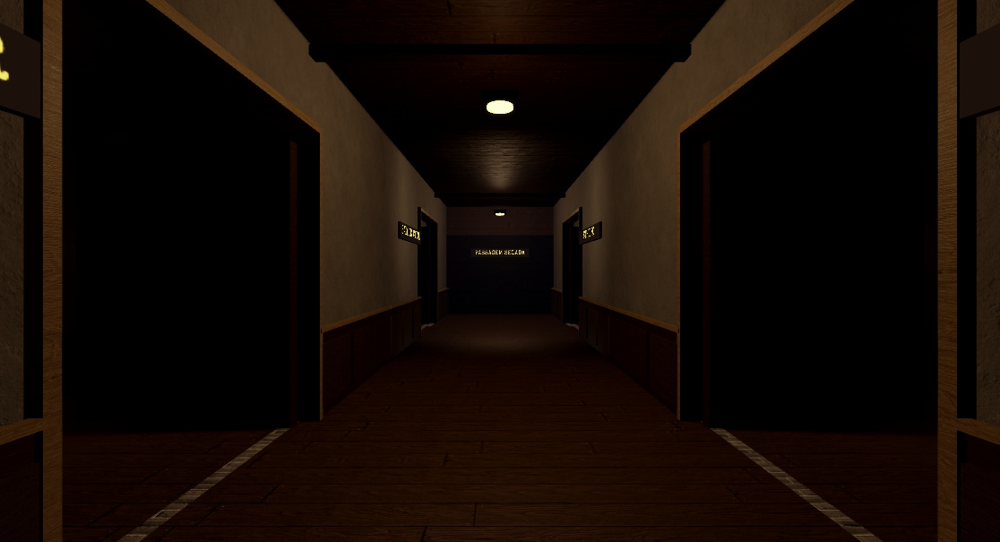
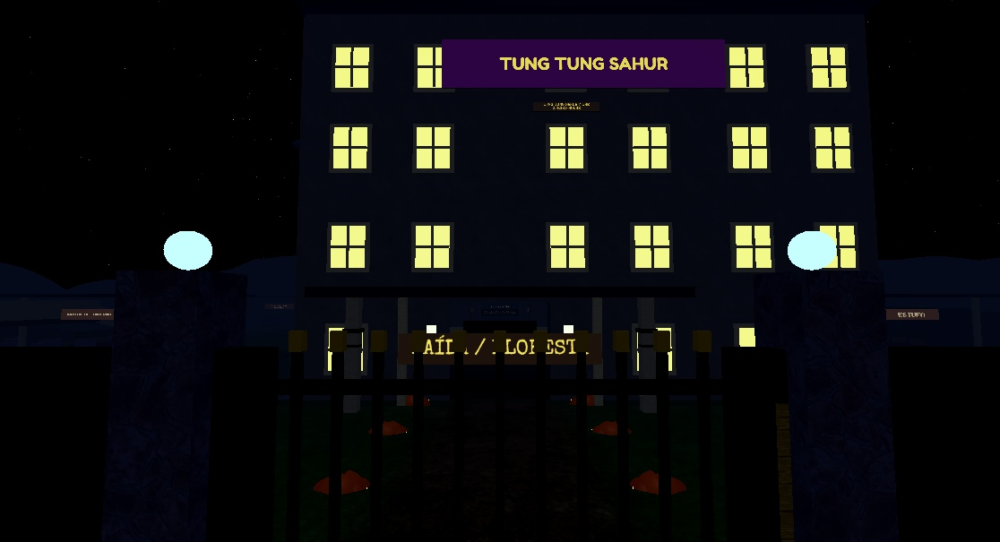
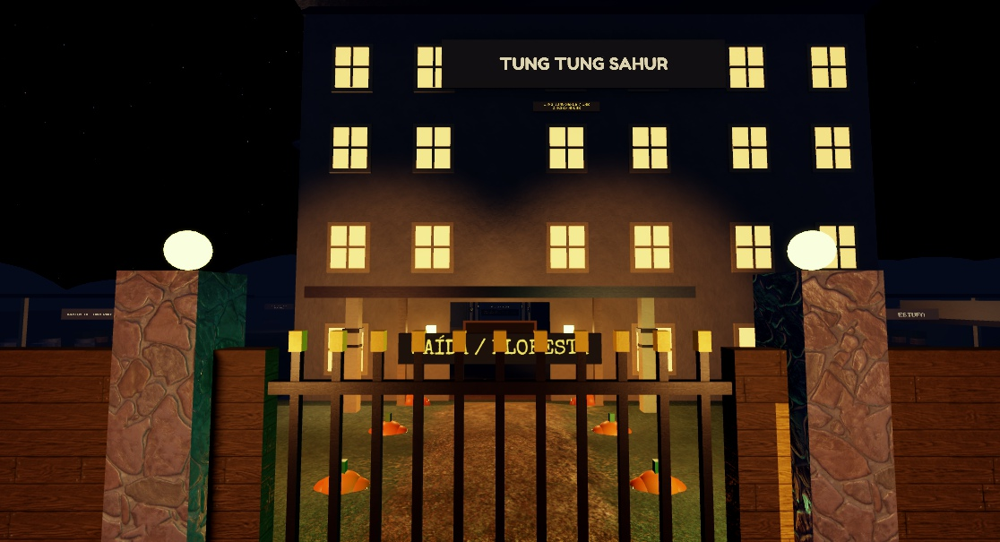
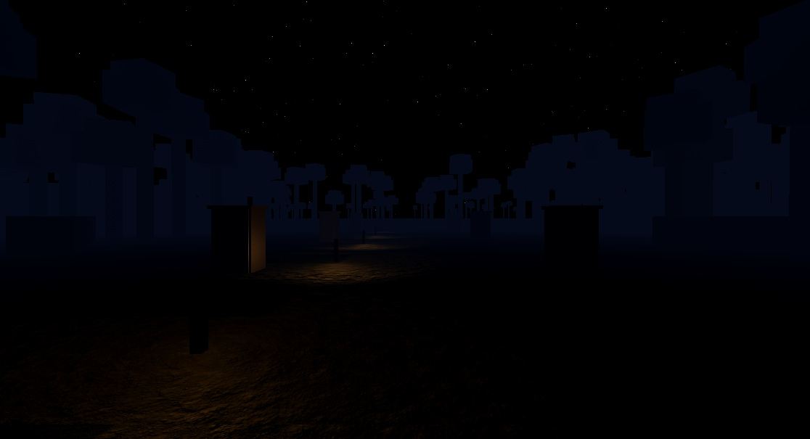
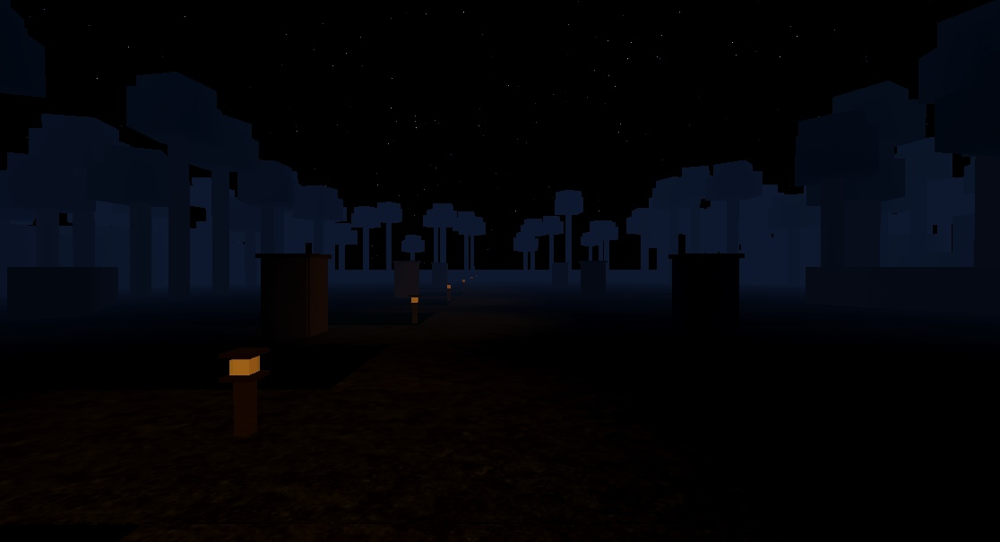

# Tung Tung Sahur — remasterização visual local

17/10/2026. Branch `codex/visual-remaster`.

## Origem e reprodução

Base conferida: `ce42900786bfc1fb6f4a31b7ccd16b226cbe8333`, branch
`codex/three-chats-integrated`, fontes em
`C:/Users/xpg/.codex/worktrees/forest-campaign/roblox-teste`.
Esse checkout tinha somente `forest-check.log` não rastreado. A pasta principal estava em
`claude/polish-terror`, HEAD `a885224`, com alterações concorrentes: foi preservada.

Fontes desta entrega: `C:/Users/xpg/.codex/worktrees/visual-remaster/roblox-teste`.
Commits de implementação: `163b877` (gráficos/preferências) e `ff5159d` (cenário/interface).
Não houve push, publicação, importação, upload ou alteração no Creator Hub.

Build: `C:/Users/xpg/Documents/roblox-teste/build/Casa_VISUAL_REMASTER_FINAL.rbxlx`.
Cópia idêntica em `build/Casa_VISUAL_REMASTER_FINAL.rbxlx` deste worktree.
SHA-256: `7824AA430DE79B8CE486DF2DCC7B6E9FA23D28B4B7FDBDCDFEA8AB9374A96E33`.
`Casa_VISUAL_REMASTER_FINAL_v3.rbxlx` e `Casa_VISUAL_REMASTER_STORY_QA.rbxlx` são cópias
dos mesmos bytes usadas no QA final. Builds intermediárias não são a entrega.

```powershell
Set-Location 'C:/Users/xpg/.codex/worktrees/visual-remaster/roblox-teste'
lune run scripts/check
rojo build default.project.json --output build/Casa_VISUAL_REMASTER_FINAL.rbxlx
./tools/audit_place.ps1 -PlacePath build/Casa_VISUAL_REMASTER_FINAL.rbxlx
```

Abrir a build no Studio e pressionar Play. Os scripts já estão embutidos; não conectar essa
place ao Script Sync da árvore antiga. A auditoria comparou **219/219 fontes**, sem divergências
ou scripts extras. `Realistic`, `Future` e `PrioritizeLightingQuality=true` estão no projeto
e no XML compilado. As cópias de QA estavam `NotSynced`, deliberadamente.

A build original `Casa_COMPLETA_3_CHATS.rbxlx` foi preservada, SHA-256
`8BFA4E4A6D9358B8B0737B623A618B1F04BE64C9AFA9102001440B02C3D9F192`.

## Acabamento e causas tratadas

| Área | Constatação no código / mudança |
| --- | --- |
| Portas da casa | `Build.part` usava plástico por padrão; portas recebem madeira nativa, mantendo CFrame, abertura, collider, tags e ID. |
| Arquitetura | Base do HouseBuilder diferenciada por função; reboco, chão e metal não dependem de um único padrão de madeira. O restyle posterior já corrigia parte das paredes. |
| Corredores/escadas | Painéis baixos, metal e difusores nas luminárias existentes. Acréscimos decorativos não colidem nem entram em raycasts. |
| Móveis | Fallback genérico de plástico substituído por madeira/tecido/metal conforme a peça; cúpulas de abajur deixam de ser blocos de neon. |
| Pistas e objetos | Chaves, fusíveis, máscara e lanterna recebem materiais coerentes; nenhum alvo funcional mudou de posição ou tamanho. |
| Áreas externas da casa | Piso de pavilhão em ardósia, vasos em tijolo, plantas em grama; fachada/letreiro e luminárias com paleta menos saturada. |
| Floresta | Lona/colchonete em tecido, coberturas em ardósia, anéis em metal; lanternas ganham vidro e proteção. |
| Trilhas sobrepostas | Interseções tinham somente 0,01 stud entre superfícies. Ramais decorativos agora se separam em 0,06 stud; não foi comprovado um defeito de UV. |
| Luz entre cômodos | Oclusão local de luzes decorativas passa a incluir abajures/chamas. Continua a 2 Hz, com transição, sem alterar Enabled ou luz de saída. |
| Floresta / orientação | Perfil funcional próprio, com ambiente frio um pouco mais legível e névoa mais distante. Pontos quentes guiam o percurso; nenhum Atmosphere foi acrescentado. |
| Loja | `DisplayOrder=80` ficava abaixo de transições em 120; passa a 220. A comparação mostrou recuperação do contraste de textos e recompensas. |
| Interface | Paleta azul escura/âmbar, contornos mais leves, ícones próprios de fôlego/bateria/oxigênio, painéis de ajustes roláveis. Fonte estilizada preservada. |
| Temporada | Barra de progresso e cartões separados de trilha gratuita/premium, com recompensa e estado textual. IDs, XP e concessões não mudaram. |

Não há evidência de UV quebrada, textura em face errada ou mapas PBR trocados na criatura.
`tools/tungtung/README.md` foi lido; o `.rbxm`, SurfaceAppearance, ossos, ClipCodec e clipes
gerados ficaram intactos. A vitrine renderizou a aparência de madeira e o preload da instância
confirmou a malha. Uma consulta separada às quatro URIs retornou Failure; isso não identifica
permissão, rede ou defeito de renderização e **não foi usado como prova de textura quebrada**.
Os recibos e a captura da vitrine preservam essa distinção. Nenhum ID externo foi acrescentado.

## Composição e perfis por jogador

`LightingController` continua como compositor artístico: ambiente, exterior, exposição,
cor, bloom e névoa. `WorldFxController` modula luminárias e escolhe sombras por proximidade/visão;
`RetroFxController` mantém o filtro cosmético 2D; `ScreenFxController` envia intensidade de perigo
ao compositor e preserva feedback. `FlashlightController` conserva alcance, brilho funcional,
bateria e pedidos autoritativos. Os dados da IA e a percepção no servidor não leem preferências.

Não há Atmosphere no runtime auditado: a névoa clássica existente foi mantida. Bloom tem
transição suave e limiar alto. DOF só pode atuar em cinematográficas, com movimento habilitado,
Shaders ON e qualidade Alta; nunca desfoca a exploração normal.

| Controle | Sombras de luminárias | Partículas decorativas | Detalhes opcionais | Bloom / DOF |
| --- | ---: | ---: | ---: | --- |
| Baixa | 0 | 0% | até 48 studs | desligados |
| Média | até 1 | 45% | até 90 studs | bloom 0,07; sem DOF |
| Alta | até 3 | 100% | até 145 studs | bloom 0,10; DOF somente cinema |
| Shaders OFF | 0 | 0% | distância do perfil | bloom/DOF/gradação opcional desativados suavemente |

Média/Alta permitem também a sombra da lanterna própria; Baixa/OFF desligam essa sombra.
A luz funcional da lanterna continua. Os percentuais se aplicam aos vaga-lumes marcados como
opcionais e à poeira da lanterna. Não desativam pistas, objetivos, beacons ou feedback de perigo.
Detalhes controlados são painéis, difusores e tampas decorativas; não incluem interagíveis.
VHS e conforto continuam com seus controles próprios; OFF também zera granulação opcional.

**Automática:** amostra uma vez o SavedQualityLevel ao iniciar. Níveis Roblox 1–3 → Baixa,
4–7 → Média, 8–10 → Alta. Quando o Roblox está em automático, usa Baixa em dispositivo de toque
e Média nos demais. Não altera as configurações internas do Roblox, não mede FPS para decidir
e não oscila durante capítulos. Selecionar um perfil manual tem efeito imediato.

As escolhas vivem no SettingsController da sessão e se aplicam às novas instâncias pelo cache
de WorldFx. Respawn não recria o ScreenGui. A remoção de objetos limpa entradas de luz, partículas
e detalhes; listeners únicos acompanham também a substituição da raiz do mundo.

## Preferências e dados

Reutilizados `HousePreferences`, `SetHousePreference`, ServerNet, Guard e rate limit.
Transporte: `shaders=0|1`; `quality=0` automática, `0.25` baixa, `0.5` média, `1` alta.
Servidor rejeita outros valores; sanitizer elimina lixo, NaN e chaves desconhecidas.
Não foi criado DataStore nem remote paralelo.

Schema **5 → 6** preenche defaults sem zerar conforto, volumes, carteira, temporada ou progresso.
O menu diferencia aplicação local, reconhecimento na sessão e confirmação pelo autosave.
O recibo de save contém o snapshot efetivamente salvo. No Studio, a mensagem é explicitamente
**“Salvo na simulação local do Studio”**; isso não comprova persistência em produção.

## Verificação e evidências

- Baseline: **276 testes locais**, ALL GREEN; **287 no Studio**, zero falhas.
- Código final: **279 testes locais**, ALL GREEN, zero lint warnings, tipos strict verdes.
  Seis specs exclusivas do engine são puladas no Lune.
- Runner sobre os bytes finais: **290 aprovados, zero falhas, zero specs puladas**.
- Todos os quatro perfis foram aplicados pelo controller vivo e pelo remote normal.
  OFF: bloom convergiu abaixo de 0,001, DOF=0, sombras opcionais=0; exposição e névoa mantidas.
- Capturas de desktop 1116×605, iPhone 17 Pro em retrato 401×778 / paisagem 750×381 e
  iPad Pro M5 1375×1032. O simulador foi restaurado. O shipping preset continua LandscapeSensor;
  retrato foi forçado como teste de robustez, sem alterar as regras do jogo.
- Em retrato, 16 botões dos ajustes tinham 44 px de altura e TextFits=true; dica e recibo também
  couberam. Textos das trilhas de temporada verificados sem cortes, com rolagem.
- Fixture de reconstrução 6→7→8, três vezes: contagens repetidas de 1535/1532/1587 descendentes.
  Ao limpar, cache voltou de 128 luzes/181 detalhes para 121/167, com três emissores decorativos.
- Desafio final em dupla: **156 verificações aprovadas**, oito capítulos, derrota/retomada,
  resgate, puzzles, respiração, extração, lobby e nova partida. Preferências verificadas antes e
  depois das transições e da nova votação. Recibo: `challenge-duo-final.json`.
- História final em dupla: **154 verificações aprovadas**, com os mesmos ciclos completos e
  preferências individuais. Recibo: `story-duo-final.json`. As sondas `story-forest-off-final.json`
  e `story-after-lobby-*.json` mostram OFF na floresta e ambos os perfis preservados depois do
  retorno e da nova votação. O resultado final `Playing`, capítulo 1, é intencional: o roteiro
  termina depois de vencer e iniciar outra partida, não antes de completar a campanha.
- Recompilação independente produziu exatamente o mesmo SHA-256; cópias entregues e build
  original preservada estão verificadas em `delivered-builds.json`.

Hardware identificado: i5-12600KF, RTX 2070, aproximadamente 32 GB RAM. Studio com outras janelas
abertas. Não foi feito benchmark representativo e não se promete FPS ou desempenho em celular.

O roteiro cooperativo usa clientes do engine, seleção real da mira e remotes normais; prepara
posições por teleporte e congela a IA. Derrota, retomada, resgate, puzzles, esconderijo/respiração,
lanterna, extração, oito capítulos, retorno automático e nova votação fazem parte do roteiro.
Isso é QA técnico; não equivale a avaliação humana de perseguição, susto ou balanceamento.

Nos clientes da História também foram registrados erros `CreatorType` em CoreGui/TopBar e
StarterScript do engine. Os recibos preservam essas mensagens separadamente dos logs dos
controllers do projeto; não são tratados como console totalmente vazio. Avisos
UIBlox/FoundationProvider também pertencem ao engine.

Tentativas anteriores ficam identificadas nos recibos. Um timeout inicial do teste gráfico
foi corrigido lendo o pedido já existente na inicialização; uma checagem antecipada de bloom
foi substituída por espera limitada pela convergência real. Retorno `nil` do StudioTestService
não é considerado aprovação. QA de builds intermediárias não aprova o código final.

## Comparação visual

Câmeras de fixture, FOV 65, energia desligada e viewport 1116×605. Corredor: olho (0,6,8),
alvo (0,6,-35). Fachada: (0,12,115) → (0,18,20). Floresta: seed 42, capítulo 6,
(0,8,620) → (0,7,720), criada pelo builder com features de teste. HUD oculto somente para captura.
As imagens finais de apresentação usam a mesma apresentação visual; as últimas diferenças de
fonte entre QA e v3 são restritas ao mecanismo de inicialização do teste.

| Cena | Antes | Depois |
| --- | --- | --- |
| Corredor |  |  |
| Fachada |  |  |
| Floresta |  |  |

Outras capturas: [temporada](evidence/visual-remaster/season-desktop.jpg),
[temporada em retrato](evidence/visual-remaster/season-portrait.jpg),
[ajustes em retrato](evidence/visual-remaster/settings-portrait.jpg),
[paisagem](evidence/visual-remaster/settings-landscape.jpg),
[tablet](evidence/visual-remaster/settings-tablet.jpg),
[criatura original](evidence/visual-remaster/creature-showcase.jpg).

## Checklist externo único

- [ ] Sessão humana com perseguição ativa, sustos, leitura com/sem energia e avaliação do acabamento.
- [ ] Toque e legibilidade em celular/tablet físicos; emulação não comprova usabilidade física.
- [ ] Benchmark no hardware alvo, incluindo aparelho de entrada, com perfil/cenário/viewport anotados.
- [ ] Confirmar salvar/reabrir preferências em backend real num ambiente de teste autorizado;
      o QA desta entrega confirmou o ciclo do MockDataStore, sem tocar dados publicados.
- [ ] Se for necessário certificar separadamente cada canal PBR, fazê-lo na instância renderizada;
      a falha da consulta por URI não determina causa nem autoriza trocar o modelo ou fazer upload.

Referências oficiais consultadas: [Lighting](https://create.roblox.com/docs/reference/engine/classes/Lighting),
[UserGameSettings](https://create.roblox.com/docs/reference/engine/classes/UserGameSettings),
[ContentProvider](https://create.roblox.com/docs/reference/engine/classes/ContentProvider) e
[SurfaceAppearance](https://create.roblox.com/docs/reference/engine/classes/SurfaceAppearance).
